# Práctica 05. Físicas.
## Introducción
En el siguiente documento se muestran las conclusiones de la experimentación con los diferentes casos propuestos en la primera actividad de la práctica.

## Índice
### Situaciones (Introducción a las físicas)
* [Situación 1](#situación-1)
* [Situación 2](#situación-2)
* [Situación 3](#situación-3)
* [Situación 4](#situación-4)
* [Situación 5](#situación-5)
* [Situación 6](#situación-6)
* [Situación 7](#situación-7)
* [Situación 8](#situación-8)
* [Situación 9](#situación-9)
### Ejercicios

## Situación 1
### Configuración
Plano (Collider) | Cubo (Rigidbody + Collider) | Esfera (Collider)
### Resultado
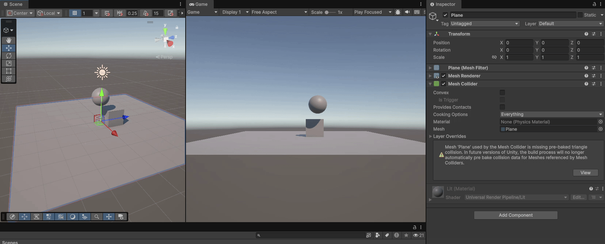
### Explicación
Dado que, por defecto al crear componentes 3D, ya los objetos tenían cada uno su *collider*, sólo fue necesario agregar el *Rigidbody* al cubo. Como es previsible, dado que la simulación física sólo ocurre en el cubo, no se aprecia movimiento en ninguna de las figuras.

Si se diera el caso de que el cubo está a una altura superior que el plano sí hubiéramos visto como caía, pues el motor simularía la gravedad (conociendo la masa del objeto) y veríamos el desplazamiento. Sin embargo, en la situación presentada, no distinguimos movimiento.

## Situación 2
### Configuración
Plano (Collider) | Cubo (Rigidbody + Collider) | Esfera (Rigidbody + Collider)
### Resultado
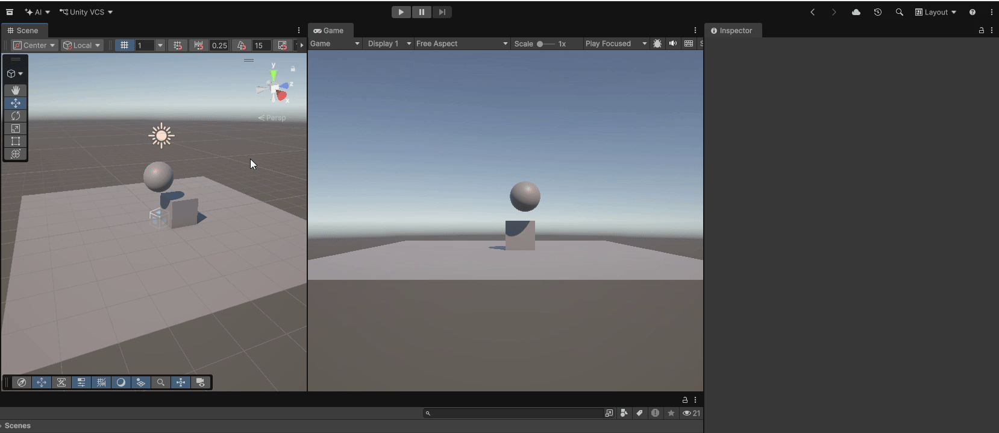
### Explicación
Este caso es ligeramente diferente al anterior. No solo porque dos objetos cuentan con *Rigidbody* y no uno, sino porque vemos el efecto comentado, la esfera cae llegando a impactar con el cubo y moviéndolo ligeramente.

Esto sucede gracias al motor de simulación de físicas que integra Unity, que en cada *time.FixedTime* va calculando la trayectoria de los objetivos que se mueven por las fuerzas, dándonos una visión realista de lo que sucede.

## Situación 3
### Configuración
Plano (Collider) | Cubo (Rigidbody + Collider) | Esfera (Rigidbody Cinemático + Collider)
### Resultado
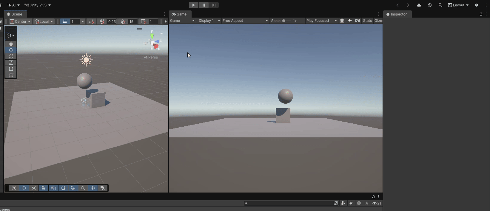
### Explicación
Esta es la primera situación en la que incluímos un componente cinemático en uno de los objetos. Que un objeto sea cinemático supone que no es incluido dentro de las simulaciones físicas. Es por ese motivo por el que la esfera no cae.

Sin embargo, tiene otras propiedades a la hora de colisionar que podremos aprovechar en momentos futuros de la práctica.

## Situación 4
### Configuración
Plano (Rigidbody + Collider) | Cubo (Rigidbody + Collider) | Esfera (Rigidbody + Collider)
### Resultado
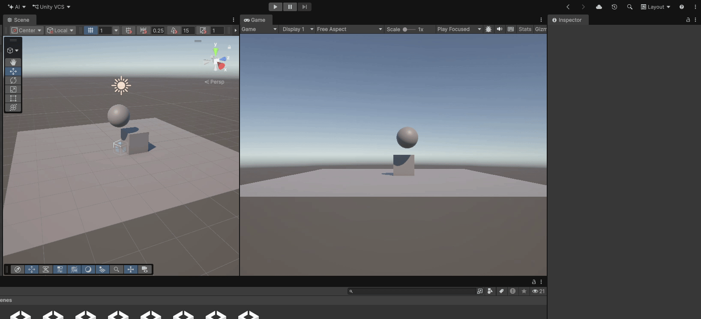
### Explicación 
A diferencia de los casos anteriores, en este escenario le hemos añadido un componente *Rigidbody* también al plano. Al no ser un objeto cinemático ni estático, la fuerza de la gravedad actúa sobre él exactamente igual que sobre el resto de las figuras.

Como consecuencia, al iniciar la simulación, el plano cae al vacío arrastrando consigo al cubo y a la esfera. Esto nos demuestra la importancia de mantener como estáticos (o cinemáticos) aquellos elementos del escenario que deben servir como superficie o apoyo fijo.

## Situación 5
### Configuración
Plano (Rigidbody Cinemático + Collider) | Cubo (Rigidbody + Collider, Masa = 1) | Esfera (Rigidbody + Collider, Masa = 10)
### Resultado
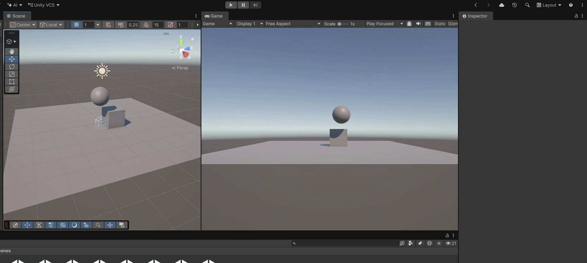
### Explicación 
Al configurar el plano como cinemático, logramos que actúe como una superficie fija inmune a la gravedad pero capaz de colisionar con otros objetos. Por otro lado, al incrementar la masa de la esfera a 10 unidades (diez veces más que la del cubo), observamos cómo impacta sobre el cubo desplazándolo con más fuerza y rapidez que en la Situación 2.

Esto ocurre porque el motor de físicas aplica principios físicos que dicen que a mayor masa y velocidad de la esfera, mayor es la transferencia de fuerza recibida por el cubo al colisionar.

## Situación 6
### Configuración
Plano (Rigidbody Cinemático + Collider) | Cubo (Rigidbody + Collider, Masa = 1) | Esfera (Rigidbody + Collider, Masa = 100)
### Resultado
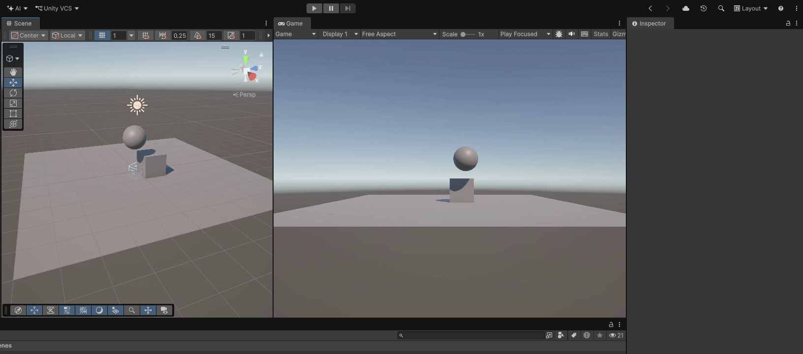
### Explicación 
En esta situación aumentamos aún más la diferencia de masa, haciendo que la esfera sea 100 veces más pesada que el cubo. El resultado es un impacto que tiene mayor fuerza haciendo que la esfera apenas reduzca su velocidad al chocar y desplace al cubo notablemente.

Vemos así el realismo que tienen las simulaciones físicas, teniendo en cuenta la masa de los objetos en su movimiento.

## Situación 7
### Configuración
Plano (Rigidbody + Collider) | Cubo (Rigidbody + Collider) | Esfera (Rigidbody + Collider con Fricción)
### Resultado
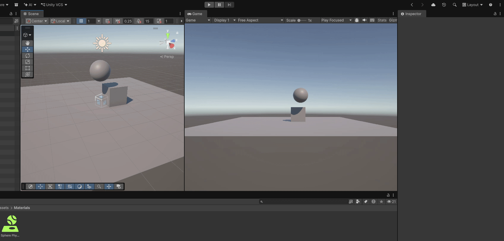
### Explicación
En este caso hemos asignado un material físico (*Physics Material*) a la esfera para modificar sus propiedades de fricción. Si hubiera colisión entre la esfera y el cubo o plano, veríamos como el material afecta a la velocidad en la que se desliza la esfera sobre la superficie.

Sin embargo, al tener un plano no cinemático (y con *Rigidbody*), este vuelve a caer por efecto de la gravedad, arrastrando a los objetos.

## Situación 8
### Configuración
Plano (Rigidbody Cinemático + Collider) | Cubo (Rigidbody + Collider) | Esfera (Rigidbody Cinemático + Collider Trigger)
### Resultado
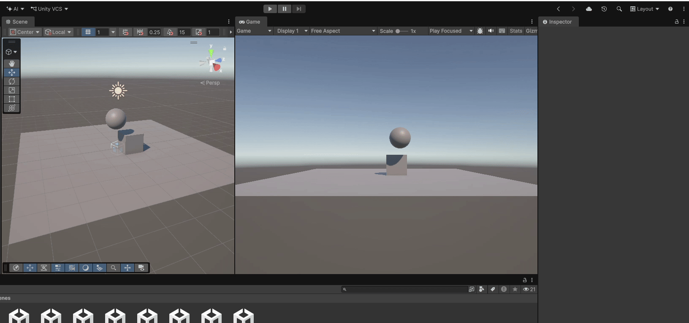
### Explicación
Al activar la propiedad *Is Trigger* en el *collider* de la esfera y ser cinemática, esta deja de responder a la gravedad. 

Como resultado, la esfera se queda flotando en el aire y no actúa como un obstáculo físico. Si otro objeto entrara en contacto con ella, la traspasaría por completo. Esto se suele usar para detectar eventos sin alterar la trayectoria física de los objetos.

## Situación 9
### Configuración
Plano (Rigidbody Cinemático + Collider) | Cubo (Rigidbody + Collider) | Esfera (Rigidbody + Collider Trigger)
### Resultado
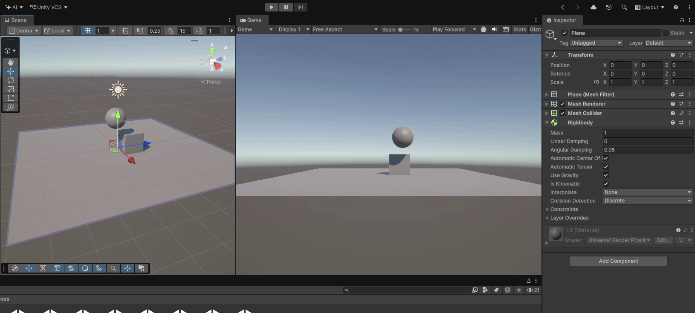
### Explicación
A diferencia de la situación 8, aquí la esfera sí cuenta con un *Rigidbody* dinámico, por lo que la gravedad sí actúa sobre ella y comienza a caer. Sin embargo, al mantener su *collider* marcado como *Is Trigger*, la esfera atraviesa completamente tanto el cubo como el plano cinemático sin colisionar con ellos ni desplazar al cubo.

Esto demuestra que un objeto puede estar sujeto a las fuerzas físicas del motor (como la gravedad) y, al mismo tiempo, comportarse como un área que se puede atravesar.

---

## Ejercicio 01. Movimiento
El fichero con el código se encuentra en [Assets/Scripts/Ejercicio01_Movimiento.cs](Assets/Scripts/Ejercicio01_Movimiento.cs)

### Descripción
Para resolver este ejercicio fue necesario crear un personaje cuyo desplazamiento pudiéramos controlar mediante las teclas WASD y las flechas y que tuviera un *RigidBody*.

### Implementación
En la implementación de este ejercicio, similar al realizado en la práctica anterior, fue necesario capturar el componente *RigidBody* para manipular la posición del objeto.

Una vez asignamos dicho componente a un objeto, no es buena práctica modificar directamente su transform, ya que el propio componente nos ofrece métodos cinemáticos como `MovePosition` o `MoveRotation` con los que desplazar el objeto si fuera necesario.

Además, tuvimos que separar la captura de datos de entrada (ejes) en el método `Update()` y la actualización de la posición del objeto en el método `FixedUpdate()`, utilizando *Time.fixedDeltaTime* como medida de tiempo.

Por último, me gustaría destacar que, profundizando un poco en lo que hicimos al final de la última práctica, donde el objeto se movía siempre en dirección *forward* y el eje horizontal solo servía para rotar, quise ver cómo se podría hacer eso con *Rigidbody*. Para lograr esto de forma adecuada (sin recurrir a `transform.Rotate`, que se saltaría la simulación física), la solución (comentada en el script) para por calcular un objeto `Quaternion` con el que luego aplicar un incremento de rotación (`MoveRotation`).

### Ejecucion
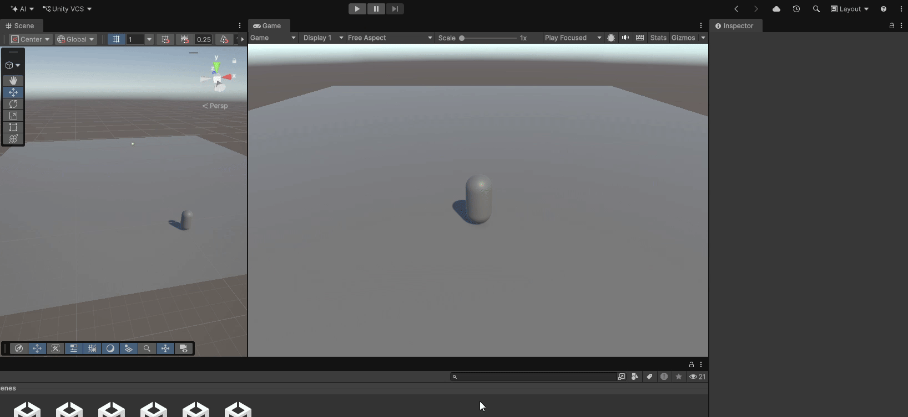

## Ejercicio 02. Cambio de Color
El fichero con el código se encuentra en 

### Descripción
El ejercicio consiste en crear varios objetos (cubos y esferas) que tengan asociado un *Rigidbody* dinámico y que, al colisionar con ellos, se cambie su color y se imprima por consola cuál ha sido la colisión.

### Implementación
Dado que ya habíamos trabajado cómo cambiar el color de un objeto utilizando scripts (cambiando la propiedad `MeshRenderer.material.color`) el principal reto estuvo en detectar las colisiones.

Para ello, creamos un script que luego agregamos a cada uno de los objetos que debían cambiar de color (cubos y esferas) que definía la función `OnCollisionEnter` de tal forma que, cada vez que se produzca una colisión, se ejecuta el bloque de código asociado a dicho método.

En nuestro caso, la aparición de una colisión, provocada por el choque de dos objetos (y al menos uno con *Rigidbody*), cambiaba la propiedad del color que ya mencionamos.

### Ejecución
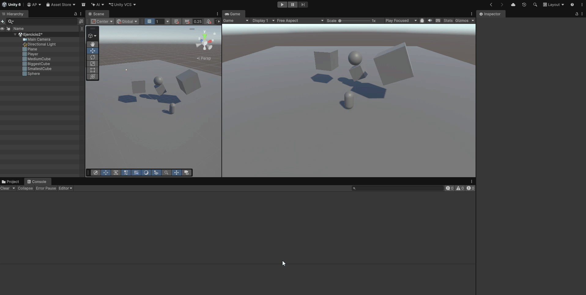